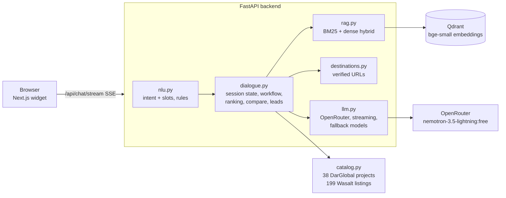

# Property Intelligence AI — DarGlobal × Wasalt

A conversational property concierge for two very different businesses:

- **DarGlobal** — an international luxury developer (branded residences in Saudi Arabia, the UAE, Oman, Qatar, Spain and the UK).
- **Wasalt** — a Saudi property marketplace (homes to buy or rent, auctions, daily rentals, Matchmaker).

A user can start with a vague idea, have a natural conversation, get real recommendations, compare options and land on the
right official page or enquiry form, without feeling they are switching between two systems.


---

## What it does

| Capability | How |
|---|---|
| **Hybrid conversation** | Type freely *or* tap quick replies. The bot remembers what you said (city, buy/rent, type, bedrooms, budget) and asks only for what's missing. Change your mind at any point ("show villas instead", "lower my budget", "start over"). |
| **Recommendations** | Ranked property cards from DarGlobal's project pages and a dated Wasalt snapshot, plus a deep link to the *live*, filtered Wasalt search page for current inventory. Buyers in Riyadh/Jeddah also see relevant DarGlobal projects. |
| **Project Q&A** | Ask about any of DarGlobal's 38 projects by name or nickname ("Les Vagues", "Trump Tower Dubai", "Neptune"). Answers are grounded in the official description. |
| **Comparison** | Tick *Compare* on 2–3 cards, or ask "compare DG1 and Les Vagues". |
| **Navigation** | Every link comes from an allow-list of verified official URLs (auctions, daily rentals, Matchmaker, list a property, investor relations, project pages). |
| **Lead capture** | In-chat enquiry form with explicit consent, plus the official "register interest" page. Contact details never go to the AI model. |
| **Honesty rules** | DarGlobal publishes no prices, so the bot says *price on request* instead of inventing one. Wasalt items are labelled as a snapshot with a link to the live listing. Unknown questions get "I don't have that", not a guess. |

## Architecture



**Design choice: rules decide, the LLM phrases.** Intent, filters, the next question, ranking, links and forms are decided by
deterministic code, so behaviour is testable and a slow or failing free model can never break search or lead capture. The LLM
(Nemotron 3.5 Lightning, reasoning disabled for ~1–3 s answers) only writes the wording, from a context block that contains the
facts it may use. If every model fails, a deterministic answer is streamed instead.

| Layer | Tech |
|---|---|
| Frontend | Next.js 15 (App Router), React 19, TypeScript, hand-written CSS (light theme), SSE streaming |
| Backend | FastAPI, Pydantic v2 |
| Retrieval | Qdrant + `BAAI/bge-small-en-v1.5` via fastembed (ONNX, CPU) + BM25, metadata filters, exact-name boost |
| LLM | OpenRouter `nvidia/nemotron-3.5-lightning:free`, fallbacks configurable |
| Deploy | Docker Compose (Qdrant, backend, frontend) + Caddy for automatic HTTPS |

### API

| Endpoint | Purpose |
|---|---|
| `POST /api/chat/stream` | Chat turn as Server-Sent Events: `meta` (cards, filters, links, quick replies), `token`s, `done` |
| `POST /api/chat` | Same turn as one JSON response |
| `POST /api/search`, `POST /api/recommendations` | Filter / rank the catalogue directly |
| `POST /api/compare` | Comparison table for 2–3 item ids |
| `GET /api/destinations` | The approved official links |
| `POST /api/leads` | Enquiry with consent (stored locally in this demo) |
| `GET /api/health`, `GET /api/stats` | Status, retrieval backend, data coverage |

Response contract (abridged):

```json
{
  "answer": "Here are 5 matches for 3-bedroom apartments for sale in Riyadh up to SAR 1.2M…",
  "intent": {"name": "search", "platform": "wasalt", "step": "results"},
  "filters": {"purpose": "sale", "city": "riyadh", "property_type": "apartment", "bedrooms": 3, "budget_max": 1200000},
  "recommendations": [{"title": "3-Bed Apartment, 104 sqm in Olaishah", "price_label": "SAR 849,000", "url": "https://wasalt.sa/en/property/sale/…"}],
  "actions": [{"label": "Live apartments for sale in Riyadh on Wasalt", "url": "https://wasalt.sa/en/apartments-for-sale-in-riyadh"}],
  "sources": [{"title": "Wasalt.sa public listings (snapshot 19 Nov 2026)", "url": "https://wasalt.sa/en"}],
  "suggested_replies": ["Show villas instead", "Lower my budget", "Compare the top two", "Talk to an advisor"],
  "ui": null
}
```

## Data and how it was collected

| Source | What | How |
|---|---|---|
| darglobal.co.uk | 38 projects: name, brand partner, location, type, bedrooms, sizes, completion date, status, image, official URL, description | The site is behind an Imperva bot challenge, which we do not bypass. The project index and pages were read in a normal browser session; the index is parsed from the page's own `__NEXT_DATA__` (`backend/app/scraper/darglobal_index.py`). **No prices**: DarGlobal does not publish them. |
| wasalt.sa | 199 listings across Riyadh, Jeddah, Dammam, Al Khobar, Makkah and Madinah (sale/rent, apartments/villas/land) | Wasalt's robots.txt allows category pages and its llms.txt allows recommending public listings with attribution at a moderate crawl rate. It answers 403 to a self-identified bot, and we don't disguise bots as browsers, so 26 category pages were read in a normal browser session at a human pace. Only listing facts were kept (no owner, broker or phone fields). See `backend/app/scraper/build_wasalt_snapshot.py`. |
| Knowledge base | 9 short documents (company overviews, brand partners, AIDA, auctions, Matchmaker, daily rentals, data notes) | Written only from statements on the official pages, each with its source URL (`backend/app/knowledge.py`). |

Data-quality rules applied to the Wasalt snapshot: apartment "built-up areas" over 600 sqm (usually the plot area) are dropped,
rents under SAR 6,000/year (usually a daily or monthly figure in the yearly field) are hidden, and sale prices outside
SAR 50k–200M are treated as typos.

## Run it locally

Requirements: Python 3.11+, Node 20+, an OpenRouter API key. Docker is optional.

```bash
cp .env.example .env            # then set OPENROUTER_API_KEY
```

**Without Docker** (Qdrant runs embedded on disk):

```bash
cd backend
python -m venv .venv && .venv/Scripts/activate      # macOS/Linux: source .venv/bin/activate
pip install -r requirements.txt
uvicorn app.main:app --port 8000
```

```bash
cd frontend
npm install
npm run dev                     # http://localhost:3000  (proxies /api to :8000)
```

**With Docker:**

```bash
docker compose up --build       # http://localhost:3000
```

## Deploy to a VPS with HTTPS

1. Create an Ubuntu VPS (2 vCPU / 4 GB is enough) and point a DNS **A record** (e.g. `chat.yourdomain.com`) at its IP.
2. Push this repo to GitHub, then on the server:

```bash
DOMAIN=chat.yourdomain.com REPO=https://github.com/<you>/property-intelligence-ai.git bash deploy/setup-vps.sh
```

The script installs Docker, clones the repo, asks you to put `OPENROUTER_API_KEY` in `.env`, then starts Qdrant, the backend,
the frontend and Caddy. Caddy obtains a Let's Encrypt certificate automatically and serves `https://chat.yourdomain.com`
(`/api/*` → FastAPI with streaming, everything else → Next.js).

## Quality

```bash
cd backend && python -m pytest -q          # 23 behaviour tests, no LLM needed
python eval/run_eval.py                    # 18 end-to-end conversations against the running API
```

Latest local run (`eval/evaluation_results.json`): **18/18 conversations passed**, 15 answers written by the LLM, average
**0.9 s per turn**. Cases cover guided search, one-shot search, rentals, changing your mind, DarGlobal by brand and country,
project questions, price honesty, comparisons, navigation, knowledge questions, lead capture, privacy and out-of-scope questions.

## Privacy and limits

- OpenRouter's free endpoints may log prompts, so names, emails and phone numbers are stripped before anything reaches the model;
  typed contact details trigger the consent form instead.
- Enquiries are stored in `data/leads/leads.jsonl` in this demo and are **not** sent to DarGlobal or Wasalt.
- Sessions live in memory (single instance). A Redis session store would be the next step for horizontal scaling.
- The Wasalt data is a snapshot from 19 Nov 2026; the bot always links to the live Wasalt page for current prices and availability.
- Independent assessment project; not affiliated with DarGlobal or Wasalt.


## 🧪 Production AI Chatbot Evaluation Suite

A rigorous automated benchmarking framework testing the chatbot across **10 evaluation categories** covering **109 test cases**.

- **Full Evaluation Documentation & Scorecard**: [evaluation/README.md](evaluation/README.md)
- **Live Interactive Dashboard**: [`http://localhost:3000/admin/evaluation`](http://localhost:3000/admin/evaluation)
- **Benchmark Highlights**:
  - **Overall Pass Rate**: `100.0%` (109 / 109 test cases passing rubric ≥3/4)
  - **Intent Accuracy**: `100.0%`
  - **Platform Routing**: `100.0%`
  - **Knowledge Boundary (Anti-Hallucination)**: `100.0%`
  - **Prompt Injection Defense**: `100.0%` (Zero critical security violations)
  - **Average Response Latency**: `183.3 ms`

To run the automated evaluation suite locally:
```bash
backend/.venv/Scripts/python evaluation/runners/run_evaluation.py --category all
```

---

## 🚀 Running the Project

### Prerequisites: Environment Setup

Make sure you have your `.env` file in the project root with your OpenRouter API key:

```env
OPENROUTER_API_KEY=your_openrouter_api_key_here
OPENROUTER_MODEL=nvidia/nemotron-3.5-lightning:free
CORS_ORIGINS=http://localhost:3000
```

### Option 1: Docker Compose (Single Command)

If you have Docker Desktop running, spin up the entire containerized stack:

```bash
docker compose up -d --build
```
- **Web UI & Chatbot**: `http://localhost:3000`
- **Evaluation Dashboard**: `http://localhost:3000/admin/evaluation`
- **Backend Health Check**: `http://localhost:3000/api/health`

### Option 2: Direct Local Development

Run the backend and frontend in two separate terminals:

**Terminal 1 — Backend (FastAPI on Port 8000)**
```powershell
cd c:\Users\Keshav\property-intelligence-ai
.\backend\.venv\Scripts\activate
$env:PYTHONPATH="backend"
python -m uvicorn app.main:app --host 127.0.0.1 --port 8000 --reload
```
- API Docs: `http://localhost:8000/docs`

**Terminal 2 — Frontend (Next.js on Port 3000)**
```powershell
cd c:\Users\Keshav\property-intelligence-ai\frontend
npm install
npm run dev
```
- Web UI: `http://localhost:3000`