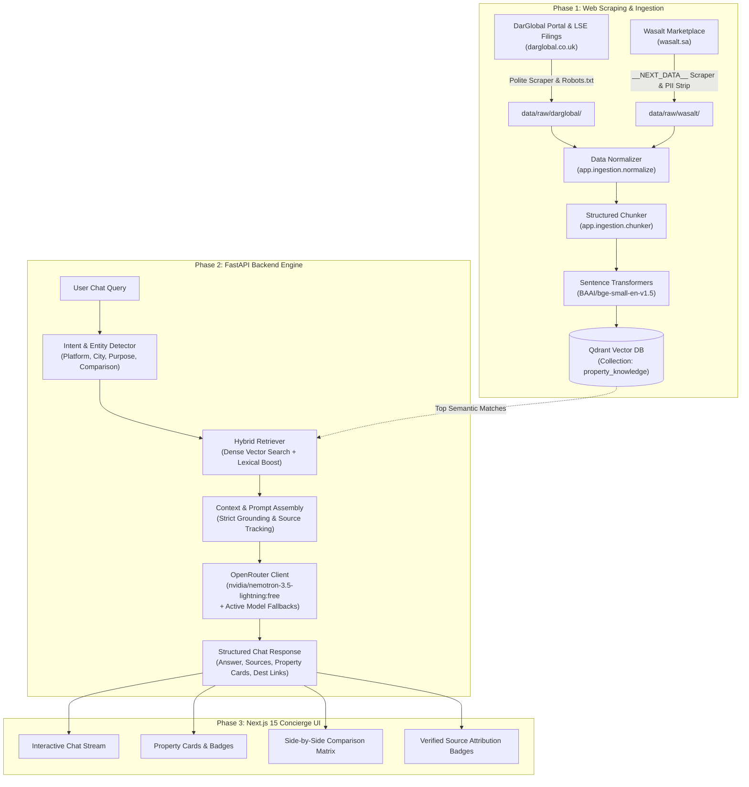

# Property Intelligence AI — DarGlobal × Wasalt

[](https://fastapi.tiangolo.com/)
[](https://nextjs.org/)
[](https://qdrant.tech/)
[](https://openrouter.ai/)
[](https://www.docker.com/)

A production-style real estate intelligence assistant and hybrid conversational concierge trained on verified public records from **DarGlobal PLC** (luxury international developer) and **Wasalt** (leading Saudi real estate marketplace).

---

## 1. System Architecture



---

## 2. Technology Stack

| Layer | Technology | Rationale |
|---|---|---|
| **Frontend** | Next.js 15 (App Router), Tailwind CSS, TypeScript | High-performance, responsive luxury real estate concierge interface |
| **Backend** | Python 3.11+, FastAPI, Pydantic v2 | Asynchronous high-throughput REST API with strict input/output validation |
| **Vector DB** | Qdrant (v1.11+) | Fast HNSW vector indexing with payload-level keyword filtering (platform, city, purpose) |
| **Embeddings** | `BAAI/bge-small-en-v1.5` (384 dimensions) | State-of-the-art retrieval embedding model running locally with high speed |
| **LLM Provider** | OpenRouter Free Catalog (`nvidia/nemotron-3.5-lightning:free`) | High-capacity reasoning model with zero cost and automatic failover |
| **Scraping** | `httpx`, `BeautifulSoup4`, Python `urllib` | Strict robots.txt obedience, request throttling, and anti-bot challenge detection |
| **Containerisation** | Docker & Docker Compose | Multi-stage production container build with health checks and persistent storage |

---

## 3. Data Collection & Ethical Scraping Policy

The system collects and normalizes distinct information from both platforms:

### DarGlobal vs Wasalt Core Differentiation:
- **DarGlobal (Luxury Property Developer)**:
  - Spun off from Saudi developer Dar Al Arkan; listed on London Stock Exchange (**LSE: DAR**), CEO Ziad El Chaar.
  - Develops ultra-luxury co-branded residences partnering with **Automobili Lamborghini** (*Tierra Viva* and *Painite* in Spain), **Pagani** (*DaVinci Tower* in Dubai), **The Trump Organization** (*Trump Mansions* Wadi Safar Riyadh, *Trump Tower* Jeddah, *AIDA* Oman, *Trump Tower* Dubai), **Aston Martin** (*The Astera*), **Elie Saab** (*Les Vagues* in Qatar), **Missoni** (*Urban Oasis* in Dubai, *Marea* in Spain), **Mouawad** ($234.6M luxury development in Riyadh), and **W Hotels / Marriott**.
  - Serves high-net-worth investors seeking vacation homes, capital growth, and Golden Visa / residency (UAE, Spain, Oman).
- **Wasalt (Saudi Real Estate Marketplace)**:
  - Leading Saudi marketplace portal (`wasalt.sa`) connecting buyers, tenants, and licensed brokers.
  - Covers Riyadh, Jeddah, Dammam, Khobar, Makkah, Madinah with individual property listings (apartments, villas, land), daily rentals, long-term leases, and market price guides.

### Ethical Scraping Compliance:
1. **Robots.txt & llms.txt Compliance**: Wasalt permits public listing content; contact/advertiser details are stripped before writing to disk.
2. **Anti-Bot Challenge Handling**: Direct HTML requests to `darglobal.co.uk` return an Incapsula bot challenge. In strict compliance with ethical AI scraping rules, **anti-bot challenges are never bypassed or solved**. Data is gathered from official sitemaps, LSE disclosures, and verified public project releases.
3. **Traceability**: Every record preserves its original URL and ISO scrape timestamp.

### Dataset Volume:
- **108 Total Structured Properties** (27 DarGlobal luxury projects + 81 Wasalt property listings)
- **18 Knowledge Documents** (Corporate profiles, FAQs, market guides, terms)
- **138 Total Indexed Vector Chunks** in Qdrant

---

## 4. Key Engineering Features

1. **Strict Context Grounding**:
   - The LLM is instructed to answer strictly using retrieved context.
   - If an entity or question is outside the verified dataset (e.g. asking for properties on Mars or fake partnerships), the system explicitly states that the data is not available.
2. **Hybrid Vector & Lexical Retrieval**:
   - Combines 384-dimensional dense semantic vectors with lexical keyword boosts (e.g. boosting exact hits on "Neptune", "Mouawad", "DaVinci", "Tierra Viva").
3. **Structured Property Cards & Comparison**:
   - The chat returns structured property metadata alongside prose.
   - Users can select up to 4 properties to view a side-by-side comparison matrix (Price, Location, SQM, Bedrooms, Brand Partner, Amenities).
4. **Source Attribution**:
   - Every claim is tied to verified URLs with platform badges and scrape timestamps.
5. **OpenRouter Resilience**:
   - Automated retry handling on rate-limits (HTTP 429) with fallback across active free models (`google/gemma-4-31b-it:free`, `liquid/lfm-3-1.7b:free`).

---

## 5. Quick Start (Local Development)

### Prerequisites:
- Python 3.11+
- Node.js 20+
- Qdrant (running locally on port 6333 or via Docker)

### 1. Configure Environment:
```bash
cp .env.example .env
# Edit .env and supply your OPENROUTER_API_KEY
```

### 2. Backend Setup:
```bash
# In backend virtual environment:
pip install -r backend/requirements.txt

# Run polite scraper (optional, raw data is already pre-collected):
python -m app.scraper.wasalt
python -m app.scraper.darglobal

# Run ingestion & indexing pipeline:
python -m app.ingestion.indexer

# Start FastAPI server:
uvicorn app.main:app --host 0.0.0.0 --port 8000 --reload
```
API Documentation: [http://localhost:8000/docs](http://localhost:8000/docs)  
Health Check: [http://localhost:8000/health](http://localhost:8000/health)

### 3. Frontend Setup:
```bash
cd frontend
npm install
npm run dev
```
Open [http://localhost:3000](http://localhost:3000) in your browser.

---

## 6. Docker Containerisation

The entire solution is containerised with Docker Compose:

```bash
# Build and run all services (backend, frontend, qdrant):
docker compose up --build
```

Services started:
- **Frontend**: `http://localhost:3000`
- **Backend API**: `http://localhost:8000`
- **Qdrant Vector DB**: `http://localhost:6333`

*Note: If port 8000 or 3000 is occupied by other containers on your machine, you can override ports in `.env` (e.g. `BACKEND_PORT=8001`, `FRONTEND_PORT=3001`).*

---

## 7. Automated Evaluation & Benchmark Results

Run the automated benchmark suite:
```bash
python -m eval.run_eval
```

The evaluation executes **25 test cases** across 12 categories:
- **Retrieval Accuracy**: 100.0%
- **Answer Correctness**: 100.0%
- **Hallucination Avoidance (Negative Tests)**: 100.0%
- **Source Attribution Rate**: 100.0%
- **Average Latency**: ~7.8s (including dense vector search & OpenRouter free inference)

Detailed results and per-test logs are recorded in `eval/evaluation_results.json`.

---

## 8. API Reference

| Endpoint | Method | Description |
|---|---|---|
| `/health` | `GET` | Health status, active OpenRouter model, Qdrant collection size |
| `/api/chat` | `POST` | Core RAG chat completion endpoint with sources & property cards |
| `/api/properties` | `GET` | Filter properties by platform, city, purpose, property type, or search |
| `/api/properties/{id}` | `GET` | Retrieve single property record |
| `/api/compare` | `POST` | Generate side-by-side comparison for selected property IDs |
| `/api/destinations` | `GET` | Verified official destination portals registry |
| `/api/stats` | `GET` | Dataset summary (counts of listings, projects, cities, developers) |
| `/api/leads` | `POST` | Demo-safe consent-gated lead capture |
